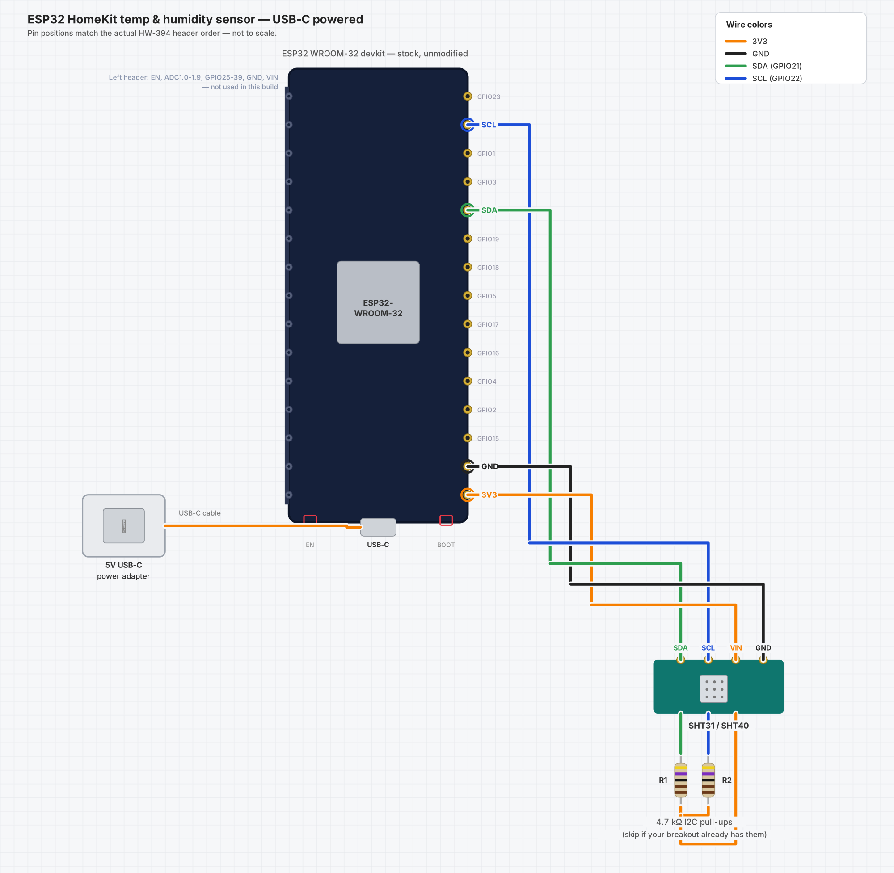

# ESP32 HomeKit Temperature & Humidity Sensor

A USB-C powered Wi-Fi temperature and humidity sensor that shows up natively in the Apple Home app. An ESP32 devkit reads an SHT31 or SHT40 over I2C and publishes the readings to HomeKit using the [HomeSpan](https://github.com/HomeSpan/HomeSpan) library. No hub, bridge or cloud account is needed, and the whole build is four parts and four wires.



`docs/wiring_diagram.svg` is the same diagram as a scalable vector.

Current version: **0.2.0** (see [CHANGELOG.md](CHANGELOG.md)). Pre-release: not yet verified on finished hardware.

---

## Features

- Native Apple Home accessory: separate temperature and humidity tiles, usable in automations
- Always connected, so the Home app shows live values rather than stale ones
- Wi-Fi credentials entered once at setup and stored on the device; nothing is hard-coded in the sketch
- Stock devkit, no soldering to the board, no modification
- Printable two-part enclosure included

## Bill of materials

| Qty | Part | Notes |
|---|---|---|
| 1 | ESP32-WROOM-32 devkit (USB-C, CH340C) | Developed on an HW-394 board; any standard 30/38-pin WROOM-32 devkit should work |
| 1 | SHT31 or SHT40 I2C breakout | Default address `0x44` |
| 2 | 4.7 kΩ resistors | I2C pull-ups. Skip them if your breakout already has pull-ups (most do) |
| 1 | 5 V USB-C power adapter, ≥ 500 mA | Any phone charger, plus a cable long enough for where you mount it |

## Wiring

Power comes from the devkit's own USB-C port. The on-board regulator supplies the 3.3 V rail that feeds the sensor.

```
USB-C power adapter ──► devkit USB-C ──► on-board regulator ──► 3V3 rail ──► SHT31/40 VIN, pull-ups
```

I2C bus:

```
        3V3 ──┬────[4.7kΩ]────┬───────────────► GPIO21 (SDA) ───► SHT31/40 SDA
              │               │
              └────[4.7kΩ]────┴───────────────► GPIO22 (SCL) ───► SHT31/40 SCL

        SHT31/40 VIN ── 3V3
        SHT31/40 GND ── GND
        ADDR pin (if broken out) tied to GND → I2C address 0x44
```

| ESP32 pin | Function | Connects to |
|---|---|---|
| `3V3` | 3.3 V supply | SHT31/40 VIN, both pull-ups |
| `GND` | Ground | SHT31/40 GND |
| `GPIO21` | I2C SDA | SHT31/40 SDA, 4.7 kΩ pull-up to 3V3 |
| `GPIO22` | I2C SCL | SHT31/40 SCL, 4.7 kΩ pull-up to 3V3 |

### Where the pins are on the HW-394

All four pins are on the **right-hand header** when the board is held with its USB-C connector at the bottom. Reading top to bottom:

`GPIO23`, **`GPIO22` (SCL)**, `GPIO1`, `GPIO3`, **`GPIO21` (SDA)**, `GPIO19`, `GPIO18`, `GPIO5`, `GPIO17`, `GPIO16`, `GPIO4`, `GPIO2`, `GPIO15`, **`GND`**, **`3V3`**

`3V3` is the pin closest to the USB-C end, with `GND` directly above it. SDA and SCL are several pins apart, so count carefully. Clone boards occasionally reorder pins, so check the silkscreen on your own board before connecting anything.

## Firmware

The sketch is in [`firmware/HomeKitTempSensor/HomeKitTempSensor.ino`](firmware/HomeKitTempSensor/HomeKitTempSensor.ino).

### Arduino IDE setup

| Setting | Value |
|---|---|
| Board package | `esp32` by Espressif Systems (Boards Manager) |
| Board | **ESP32 Dev Module** |
| Partition Scheme | **Huge APP (3MB No OTA/1MB SPIFFS)** |
| Libraries | **HomeSpan**, **Adafruit SHT31 Library** (and its Adafruit BusIO dependency) |

The partition scheme matters. A HomeSpan build is about 1.4 MB, and the default scheme allows only about 1.3 MB for the app, so compiling fails with `Sketch too big`.

For an SHT40, install **Adafruit SHT4x** instead and swap the `sht31.*` calls for the SHT4x equivalents.

### First-time Wi-Fi setup

No SSID or password is stored in the sketch. Enter them once; they are saved to the ESP32's flash and reused on every boot.

**Option A: setup hotspot.** The sketch calls `enableAutoStartAP()`, so a freshly flashed board with no stored credentials starts a hotspot on its own:

1. On a phone or laptop, join the Wi-Fi network **`HomeSpan-Setup`** (password **`homespan`**).
2. Choose your home network and enter its password on the page that opens.
3. The board saves the credentials and restarts.

**Option B: Serial Monitor.** Open the Serial Monitor at 115200 baud with the line ending set to *Newline*, type `W`, and follow the prompts. It scans for networks, asks which to join, and asks for the password.

To reopen the setup hotspot later, either type `A` in the Serial Monitor or use the BOOT button: hold it for 3 seconds to enter command mode, press briefly to step through the actions until you reach action 3 (Launch Access Point), then hold for 3 seconds to run it. Holding for 10 seconds performs a factory reset. The sketch assigns the BOOT button (GPIO0) as HomeSpan's control button.

### Status LED

The on-board LED (GPIO2) shows the Wi-Fi state:

| LED | Meaning |
|---|---|
| Blinking | Not connected to Wi-Fi yet: connecting, or waiting for first-time setup |
| Solid on | Connected to Wi-Fi and running |

If the connection drops, the LED goes back to blinking until it reconnects. It shows Wi-Fi only: a solid LED does not mean the accessory is paired in Home.

### Pairing with Apple Home

1. Open the Home app, tap **+**, then **Add Accessory**.
2. Choose **Temp Sensor** from the list of nearby accessories.
3. Enter the setup code. The default is **`466-37-726`**.
4. iOS warns that the accessory is not Apple-certified. That is expected for HomeSpan; accept it to continue.

Set your own code by typing `S` followed by eight digits in the Serial Monitor. Only a hash of the code is stored, so a forgotten code can't be read back; set a new one instead. A device that is stuck, or was paired and then removed from Home, can be reset with `U` (unpair) or `F` (factory reset).

### Reading interval

The sensor is read and published every 15 minutes by default. Change `READ_INTERVAL_MS` at the top of the sketch (for example `60000` for every minute).

### Troubleshooting uploads

Symptom: esptool connects and prints the chip details, then fails with `Unable to verify flash chip connection`, often right after `Changing baud rate to 921600`.

- Set **Tools > Upload Speed** to **115200** (the default is 921600). Check that the setting stuck before uploading again.
- Put the board in bootloader mode by hand: hold **BOOT**, tap **EN** once, then release BOOT, and start the upload within a few seconds.
- Try a different USB cable, plugged directly into the computer rather than a hub. A cable that carries enough data to identify the chip can still drop out during the flash write.
- Close the Serial Monitor and anything else that has the serial port open.
- To test the board and cable without the IDE, install [esptool](https://github.com/espressif/esptool) and run `esptool --chip esp32 --port <your port> --baud 115200 read-mac`. If that succeeds, the board, cable and drivers are fine and the problem is in the upload settings.

## Enclosure

A two-part, screw-together box in [`hardware/enclosure/`](hardware/enclosure/): `case_base.stl`, `case_lid.stl`, and the parametric source `sensor_case.scad`.

- One USB-C cutout, plus a vent grille over the sensor so it reads room air rather than the board's own heat
- Four M3 screw bosses and internal rails that hold the devkit in place
- Sizing is generic, not measured to a specific board. Print the base first as a fit check and adjust the parameters at the top of the `.scad` file if needed

To regenerate the STLs:

```sh
openscad -D 'PART="base"' -o case_base.stl sensor_case.scad
openscad -D 'PART="lid"'  -o case_lid.stl  sensor_case.scad
```

Mount the sensor away from the USB adapter and the ESP32's own heat. The vent grille helps, but the board warms the air inside the box a little, so expect readings slightly above true room temperature.

## Repository layout

```
.
├── README.md
├── CHANGELOG.md
├── VERSION
├── docs/
│   ├── wiring_diagram.png
│   └── wiring_diagram.svg
├── firmware/
│   └── HomeKitTempSensor/
│       └── HomeKitTempSensor.ino
└── hardware/
    └── enclosure/
        ├── sensor_case.scad
        ├── case_base.stl
        └── case_lid.stl
```

## Versioning

The project uses [Semantic Versioning](https://semver.org/) and each release is a git tag (`v0.1.0`, and so on). To release: update `VERSION`, `FW_VERSION` in the sketch and `CHANGELOG.md`, commit, then `git tag -a vX.Y.Z -m "vX.Y.Z"`.

## Notes

- HomeSpan is an open-source implementation of the HomeKit Accessory Protocol. It is not Apple-certified, which is why iOS shows a warning at pairing. That is fine for personal use.
- The sketch folder is named to match the `.ino` file, which the Arduino IDE requires.
