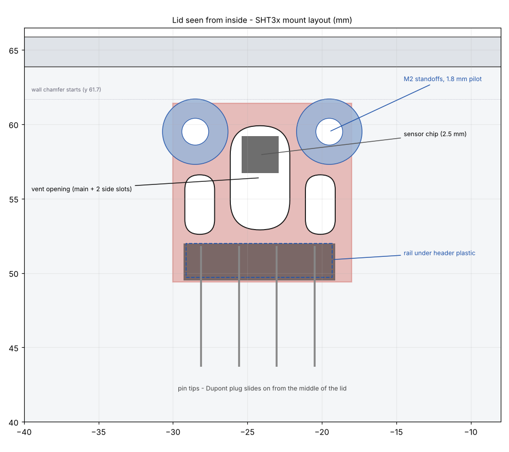
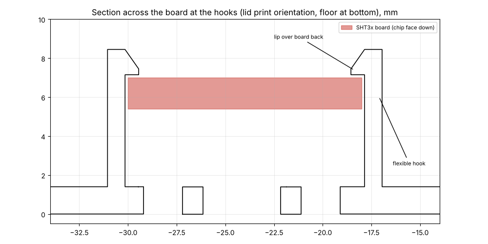

# Housing

The housing is the **ESP Smart Home Case | Parametric | Antenna** by **i-BoxIt** on MakerWorld, with a sensor mount added to the lid for an SHT3x-DIS breakout.

- Original model: <https://makerworld.com/en/models/2540084-esp-smart-home-case-parametric-antenna>
- Designer: i-BoxIt, <https://makerworld.com/en/@i.boxit>
- Licence of the original: MakerWorld **Standard Digital File License**

## What is and isn't in this repository

The Standard Digital File License does not allow sharing or hosting the original files or any modified version of them, remixes included. So **no STL of the case, original or modified, is committed here**, and `.gitignore` blocks `hardware/enclosure/*.stl` so one can't be added by accident.

What is here is original work that contains no part of the model:

| File | What it is |
|---|---|
| `add_sht3x_mount.py` | Script that reads the case STL you downloaded and writes a lid with the sensor mount added |
| `requirements.txt` | Python packages the script needs |
| `mount_section.png`, `mount_layout.png` | Drawings of the mount, for reference |

Downloading the case from MakerWorld and running the script on your own machine gives you the modified lid for your own use.

## Building the modified lid

1. Download the case from the MakerWorld page above (you need a MakerWorld account) and save the STL as `hardware/enclosure/source/ESP_Smart_Home_Case_V2.3.stl`. The script was written against the lid of that file, which measures 68.5 × 64.8 × 21.4 mm, and stops with a message if the lid is a different size.
2. Install the dependencies and run the script from `hardware/enclosure/`:

   ```sh
   python3 -m venv .venv && source .venv/bin/activate
   pip install -r requirements.txt
   python3 add_sht3x_mount.py source/ESP_Smart_Home_Case_V2.3.stl lid_sht3x_SNAP.stl plate_sht3x_SNAP.stl snap
   ```

3. Print `plate_sht3x_SNAP.stl` (the full print plate with the new lid swapped in) or `lid_sht3x_SNAP.stl` (the lid alone). Use `bolt` instead of `snap` for a screw-mounted version.

The case page lists a default board size of 51.6 × 28.4 × 1.6 mm. Check that your devkit fits the base before printing the full set; this has not been verified for the HW-394 yet.

## What the script changes on the lid



- **Sensor mount.** The SHT3x-DIS board (about 12 × 12 mm) hangs chip-down, 4 mm above the inside of the lid floor, near the +y wall. Two small pegs go through the board's corner holes to locate it, and two flexible hooks click over the back of the board, so no screws are needed. A small rail supports the plastic of the right-angle header.
- **Vent opening.** The chip sits directly over a slot cut through the lid floor, with two smaller slots beside it, so the sensor reads outside air.
- **Pins.** The right-angle header points toward the middle of the lid so a Dupont connector can slide on.
- **Logo.** The case has a 0.4 mm logo engraved on the outside of the lid. It is flattened so the mesh is a clean closed shell. Nothing else on the lid is altered.



### Printing

- Print the lid in **PETG**. Each hook flexes about 0.55 mm to let the board in, which is roughly 1.5 to 1.9 % strain at the base. That is comfortable for PETG and marginal for PLA, especially because the hooks print standing up.
- Print with the outside of the lid face down, as the file is oriented.
- Do a lid-only fit test before printing the whole plate.
- To remove the board, push a hook outward at the top with a fingernail.

### Assumptions to check

The board dimensions were measured from a product photo, not with calipers. Check them against your board and edit the parameters at the top of the script if they differ.

| Parameter | Assumed |
|---|---|
| Board size | 12 × 12 × 1.6 mm |
| Mounting holes | about 2 mm diameter, 1.5 mm in from each side, 1.9 mm up from the bottom edge |
| Sensor chip | 3.45 mm up from the bottom edge, centred |
| Header | right-angle, plastic about 2.5 mm tall, pins along the top edge pointing away from the board |

The two pegs only fit if the holes match. If they don't, set `PEG_D` and the hole positions, or remove the pegs. The two hooks hold the board on their own.

### Fit status

The generated lid has been checked in software (watertight, no collisions with a model of the board, vent opening directly under the chip) but **has not been printed yet**.
